# مشوار: منصة التنقّل المجدول

منصة سعودية لاشتراكات التوصيل اليومي: يشترك الطالب أو الموظف شهريا، ويوصله سائق ثابت في مواعيد ثابتة من البيت إلى المدرسة أو العمل والعودة. يقدّم الخدمة شريك نقل مرخّص من الهيئة العامة للنقل، وتوفّر المنصة التقنية: تطبيق الراكب، وتطبيق السائق، ولوحة تشغيل للشريك، والدفع والفوترة.

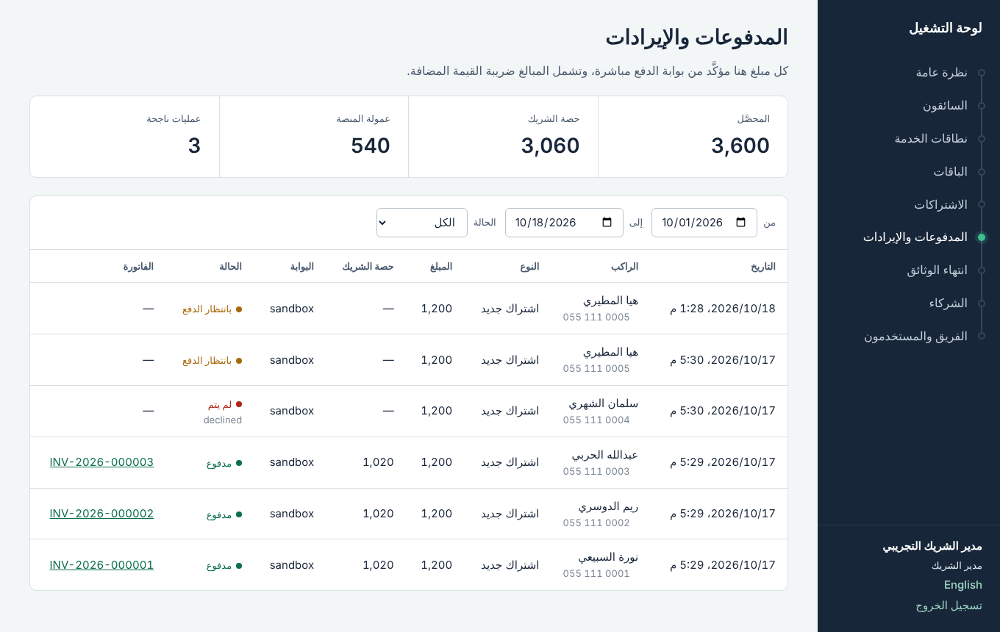

## ماذا يفعل

**للراكب (تطبيق جوال)**
- يحفظ أماكنه (البيت، المدرسة، العمل) بتحريك الخريطة تحت دبوس.
- يرى الباقات المتاحة عند بيته، والسعر الشهري شاملا الضريبة، ويتأكد أن المسافة ضمن الباقة.
- يختار أيام الأسبوع ووقتي الذهاب والعودة، ثم يدفع بمدى أو البطاقة أو Apple Pay أو STC Pay.
- يتجدد اشتراكه شهريا من بطاقته المحفوظة، ويوقفه مؤقتا عند السفر (تُضاف الأيام لنهاية الاشتراك)، ويستلم فاتورة ضريبية بعد كل دفعة.

- يضيف أبناءه أو أفراد عائلته ويشترك لكل واحد منهم من حسابه، ويستخدم رمز خصم عند أول دفعة.
- يرى رحلته القادمة، ويتابع السائق على الخريطة مباشرة مع وقت الوصول المتوقع ولوحة السيارة، ويلغي رحلة يوم واحد.
- يرسل رابط تتبع لأحد أهله يفتح في أي متصفح دون تطبيق، وينتهي الرابط تلقائيا بعد الرحلة.
- يقيّم الرحلة بعد انتهائها، ويفتح طلب دعم ويتابع الرد من داخل التطبيق.

**للسائق (تطبيق جوال)**
- ينضم لشريك برمز، ويدخل بياناته ومركبته، ويرفع وثائقه الست من الجوال، ويتابع حالة طلبه.
- يرى رحلات اليوم على شاشة داكنة سهلة القراءة أثناء القيادة، ويمر بخطوات الرحلة: انطلقت، وصلت، ركب الراكب، أنهيت، أو لم يحضر.
- يتصل بالراكب أو يفتح الملاحة بضغطة، ويرسل موقعه كل 10 ثوان أثناء الرحلة.

**للشريك (لوحة تشغيل على الويب)**
- يراجع طلبات السائقين ووثائقهم ويعتمدها أو يعيدها بملاحظات على كل وثيقة.
- يرسم نطاقات الخدمة على الخريطة، وينشئ الباقات وأسعارها.
- يتابع الاشتراكات والمدفوعات وحصته من كل دفعة، ويفتح الفواتير.
- ينبهه النظام قبل انتهاء أي وثيقة، ويوقف السائق تلقائيا عند انتهائها.
- يتابع تشغيل اليوم من شاشة واحدة: الرحلات المتأخرة وبدون سائق، ومواقع السيارات على الخريطة، ويعيّن سائقا ثابتا لكل اشتراك أو بديلا لرحلة واحدة.
- يقرأ التقارير: الإيراد اليومي والاشتراكات الجديدة ونسبة الالتزام بالموعد ومتوسط التقييم، ويصدّر المدفوعات لملف Excel.
- يرد على طلبات الدعم، ويرى تقييمات السائقين، وينشئ رموز الخصم.

## لقطات

| | |
| --- | --- |
| 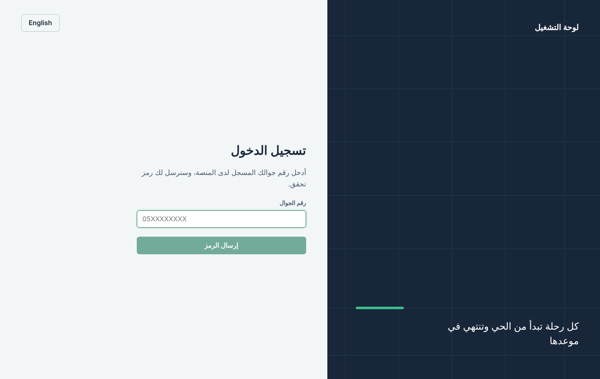 | 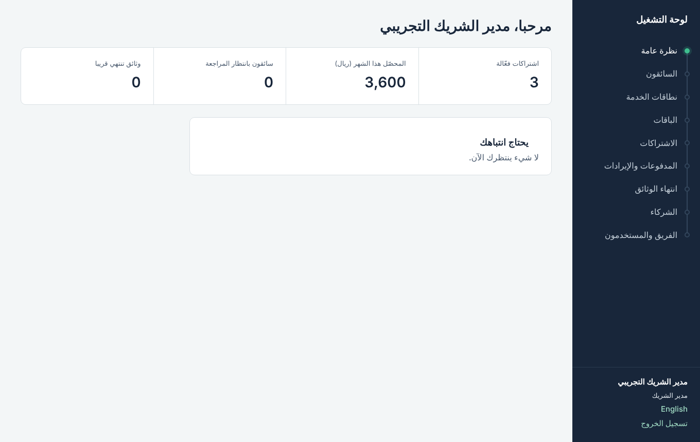 |
| الدخول برمز تحقق يصل للجوال | نظرة عامة: الاشتراكات والمحصّل وما ينتظر المراجعة |
| 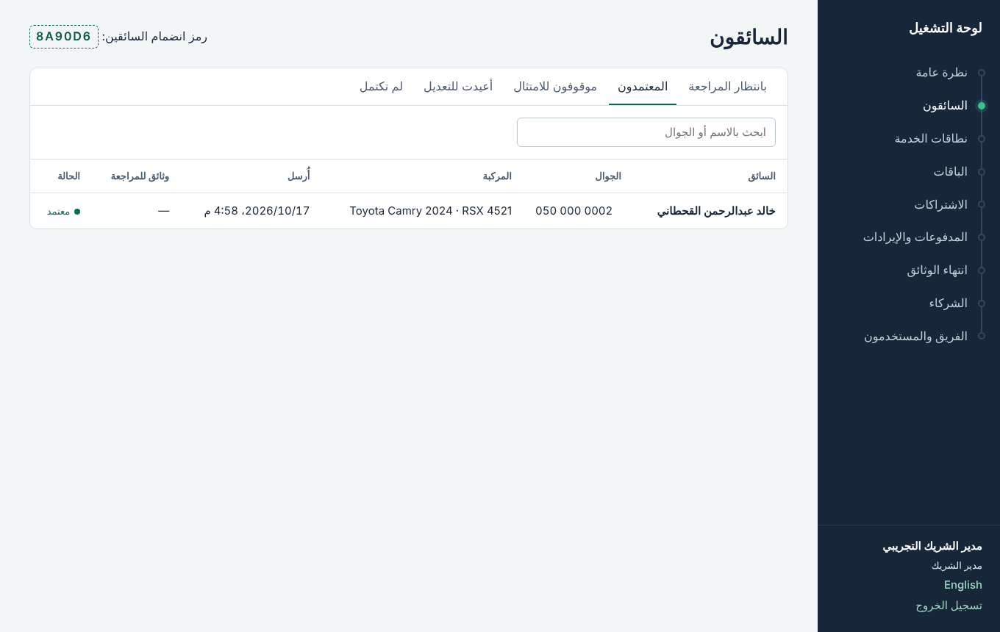 | 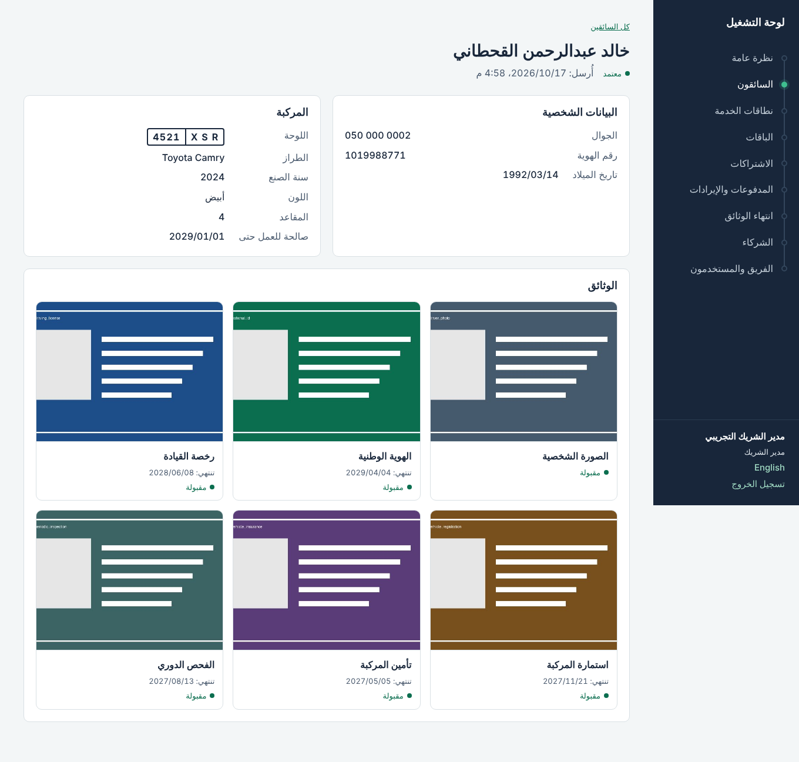 |
| السائقون المعتمدون ومركباتهم | مراجعة سائق: البيانات واللوحة والوثائق الست |
| 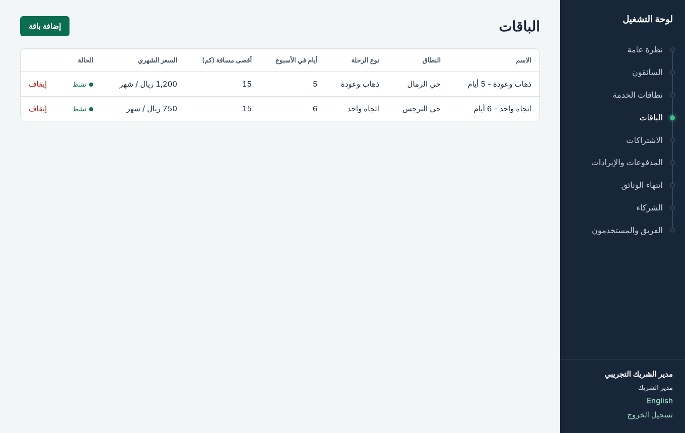 | 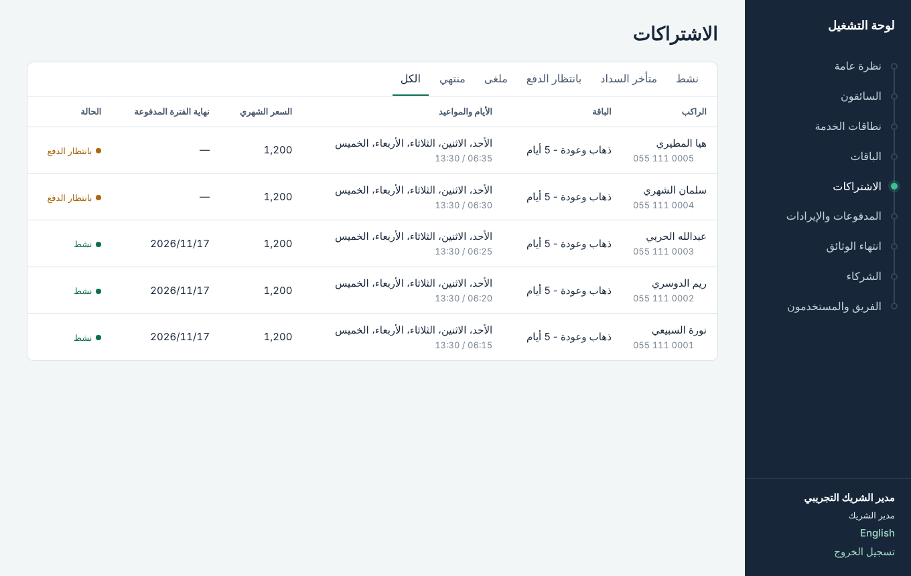 |
| الباقات: نوع الرحلة والأيام والسعر وأقصى مسافة | الاشتراكات وحالاتها ومواعيدها |
| 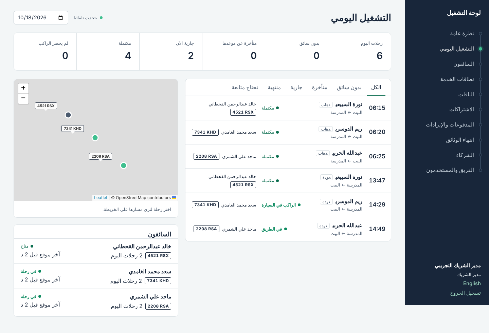 | 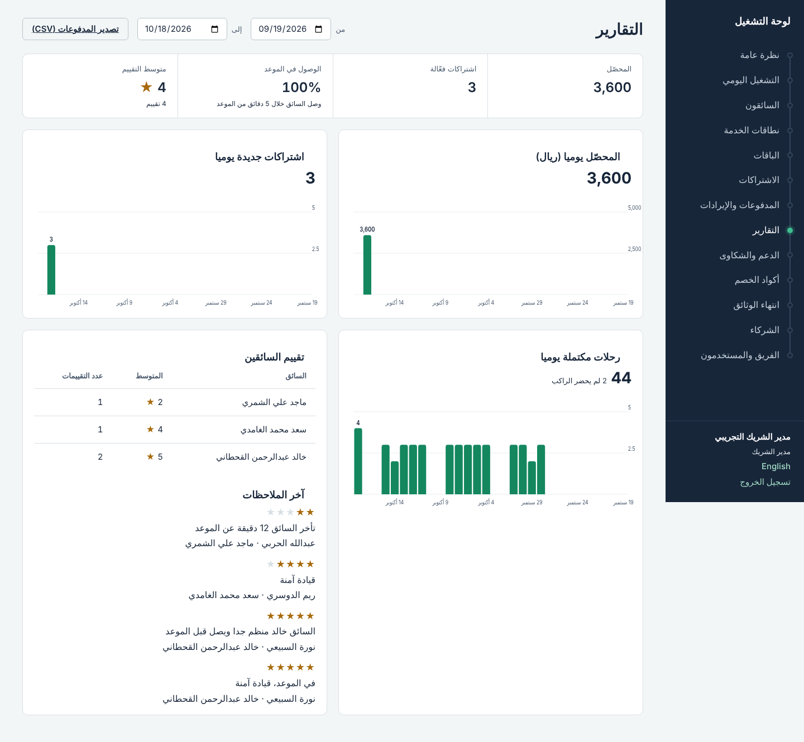 |
| التشغيل اليومي: رحلات اليوم ومواقع السيارات | التقارير اليومية وتقييمات السائقين |
| 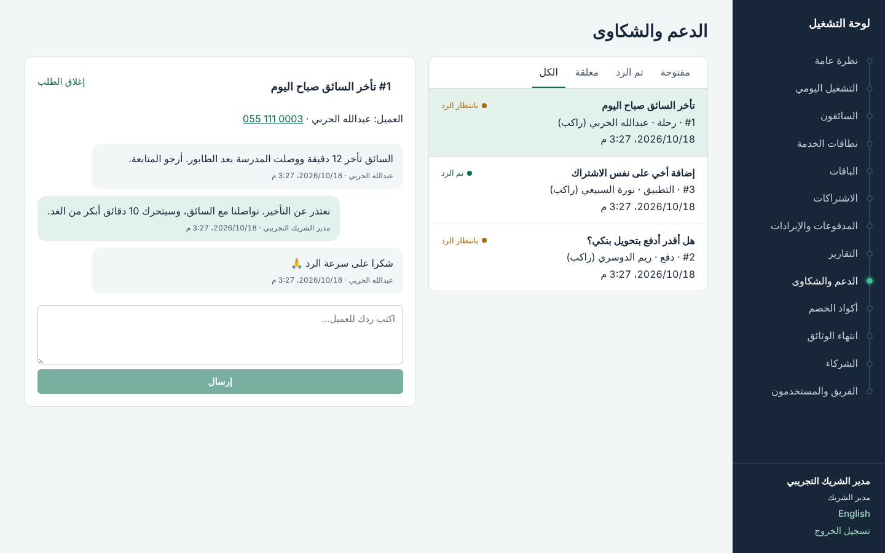 | 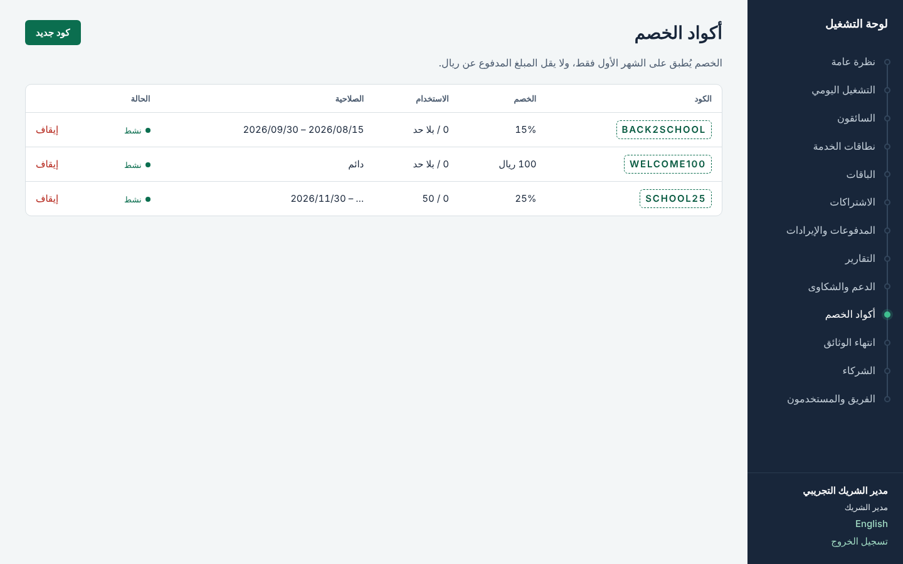 |
| صندوق طلبات الدعم | رموز الخصم |
| 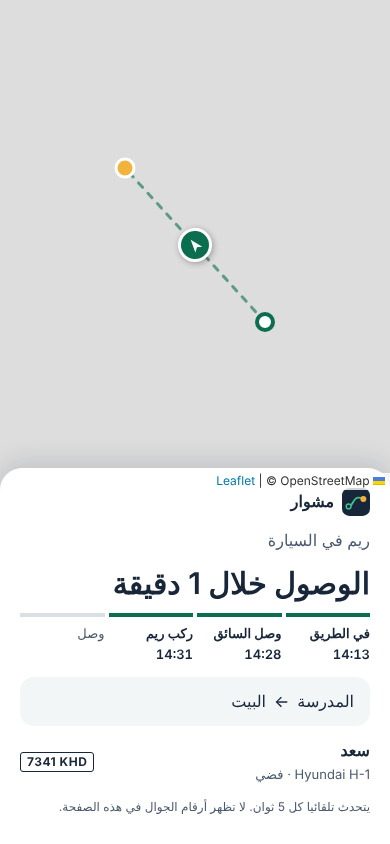 | |
| صفحة التتبع التي تصل للأهل | |
| 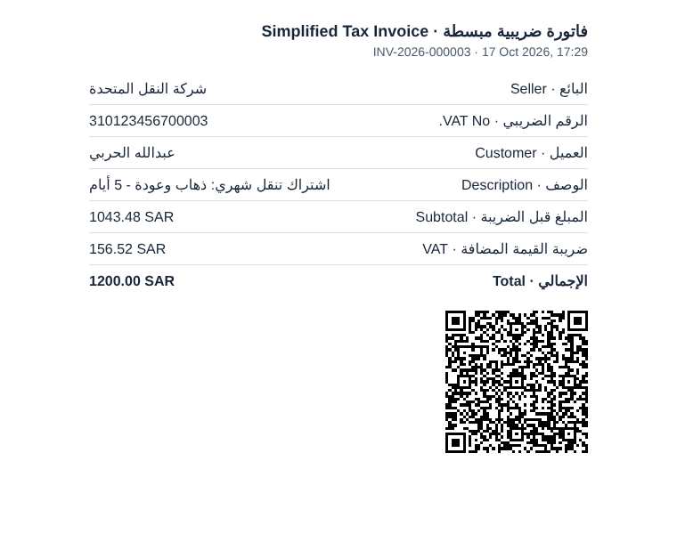 | 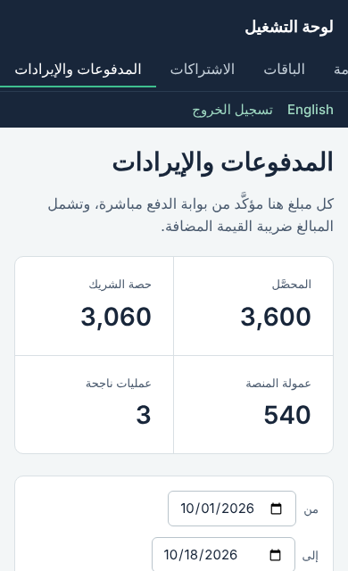 |
| فاتورة ضريبية مبسطة برمز QR | اللوحة على شاشة الجوال |

## الدفع والفوترة

- **Tap** بوابة أساسية: صفحة دفع واحدة لكل الطرق، وخصم شهري تلقائي من البطاقة المحفوظة (مدى أيضا)، وتحويل حصة الشريك إلى حسابه مباشرة مع كل دفعة.
- **Moyasar** بديل جاهز، والتبديل بإعداد واحد. وبيئة دفع تجريبية للتطوير.
- لا تُعتمد أي دفعة من صفحة العودة أو من إشعار البوابة؛ الخادم يتأكد من البوابة مباشرة، ولكل عملية مفتاح يمنع الخصم المزدوج.
- الفاتورة باسم الشريك ورقمه الضريبي، برمز QR بصيغة «فاتورة» (المرحلة الأولى)، وأرقام متسلسلة لكل سنة.
- التجديد يعمل يوميا 05:00 بتوقيت الرياض؛ عند فشله يبقى الاشتراك فعالا 3 أيام مع رابط دفع وإشعار.

## التقنية

| الجزء | المجلد | التقنية |
| --- | --- | --- |
| الخادم (API) | `apps/api` | NestJS، PostgreSQL + PostGIS، Redis و BullMQ، Drizzle ORM |
| لوحة التشغيل | `apps/admin` | Next.js و React، عربي وإنجليزي، Leaflet للخرائط |
| تطبيق الراكب | `apps/rider_app` | Flutter، Riverpod، flutter_map |
| تطبيق السائق | `apps/driver_app` | Flutter |
| الكود المشترك للتطبيقين | `packages/mobile_core` | Flutter |
| عقد الواجهات | `packages/contracts/openapi.json` | OpenAPI يُولَّد من الخادم |

**الأمان:** دخول برمز تحقق مع حدود للمحاولات، رموز وصول قصيرة ورموز تجديد تتبدّل مع كل استخدام، عزل تام لبيانات كل شريك، سجل تدقيق لكل تعديل إداري، تشفير أرقام الهويات (AES-256-GCM)، والتحقق من نوع الملفات من محتواها لا من اسمها.

**الجودة:** أكثر من 100 اختبار آلي للخادم (وحدات وتكامل مع قاعدة بيانات حقيقية)، واختبارات للوحة والتطبيقات، وفحص تلقائي مع كل رفع (GitHub Actions).

## التشغيل

### على جهازك (أسهل طريقة)
ثبّت Docker Desktop، ثم شغّل `start.bat` (ويندوز) أو `bash start.sh` (ماك ولينكس). افتح `http://localhost:3001` وادخل بالرقم `0500000000` والرمز `123456`. توثيق الـ API على `http://localhost:3000/docs`.

### على خادم
خادم مجاني (Oracle Cloud) أو أي خادم Ubuntu، بأمر واحد مع شهادة HTTPS تلقائية. الخطوات في [`docs/deploy.md`](docs/deploy.md).

### التجربة التجارية دون تكاليف
الإعدادات الافتراضية للخادم تشغّل تجربة مغلقة بالدعوة:
- الدخول برموز ترسلها بالواتساب بدل SMS.
- الدفع بالتحويل وتسجيله من اللوحة.
- إشعارات مجانية عبر Firebase.
- نسخة ويب لتطبيق الراكب على الآيفون.

الخطوات وإجراءات التشغيل اليومي في [`docs/pilot.md`](docs/pilot.md).

### تطبيقات أندرويد ونسخة الآيفون
من تبويب Actions شغّل «Release builds» وأدخل عنوان الخادم. يُنشر إصدار فيه:
- تطبيقا الراكب والسائق موقّعان.
- نسخة الويب، وينزلها الخادم بالأمر `bash update.sh`.

صفحة `/download` في اللوحة تشير دائما لآخر إصدار.

### للمطوّرين
المتطلبات: Node.js 22، pnpm 10، Docker، Flutter 3.24+.

```bash
pnpm install
docker compose -f infra/docker-compose.yml up -d     # PostgreSQL+PostGIS و Redis فقط
cp apps/api/.env.example apps/api/.env
pnpm --filter @ride/api db:migrate:dev
pnpm --filter @ride/api db:seed:dev -- --demo        # مدير المنصة + شريك تجريبي + نطاق وباقات
pnpm dev:api                                         # http://localhost:3000
cp apps/admin/.env.example apps/admin/.env.local
pnpm dev:admin                                       # http://localhost:3001
```

التطبيقات (أول مرة فقط، لإنشاء مجلدات المنصات دون تغيير `lib/`):

```bash
cd apps/rider_app
flutter create --platforms=android,ios --org sa.yourcompany --project-name rider_app .
flutter run --dart-define=API_URL=http://10.0.2.2:3000
```

الاختبارات:

```bash
pnpm --filter @ride/api test        # يحتاج قاعدة ride_test و Redis
pnpm --filter @ride/admin test
cd packages/mobile_core && flutter test
```

## مراحل البناء

| المرحلة | المحتوى | الحالة |
| --- | --- | --- |
| 1 | الأساس: الحسابات والصلاحيات والدخول واللوحة | مكتملة ([التفاصيل](docs/phase-1.md)) |
| 2 | السائقون والمركبات والوثائق، النطاقات والباقات | مكتملة ([التفاصيل](docs/phase-2.md)) |
| 3 | تطبيق الراكب، الاشتراكات، الدفع، الفاتورة | مكتملة ([التفاصيل](docs/phase-3.md)) |
| 4 | الرحلات اليومية والتتبع المباشر، الحسابات العائلية، الخصومات، التقييم والدعم، التقارير، هوية «مشوار» | مكتملة ([التفاصيل](docs/phase-4.md)) |
| 5 | التجربة التجارية: الدخول بالدعوة، طلبات الانضمام، الدفع اليدوي، الإشعارات، زر الطوارئ، تنبيهات التأخير، نسخة الويب | مكتملة ([الدليل](docs/pilot.md)) |

## قبل الإطلاق التجاري

- مزوّد رسائل SMS سعودي (الخادم يرفض العمل في الإنتاج دونه).
- حساب تاجر في Tap مع مدى و Apple Pay وخاصية تقسيم المبالغ، وتجربة التدفق بمفاتيح Tap التجريبية.
- أسرار قوية ومختلفة لكل بيئة (سكربت الخادم يولّدها تلقائيا).
